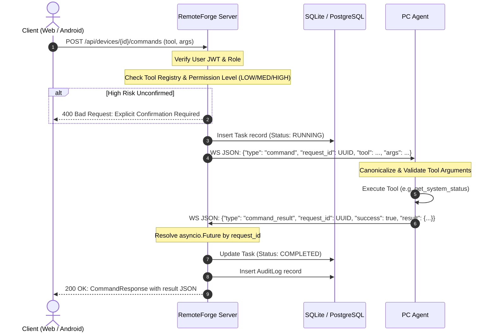

# RemoteForge Architecture Specification

## 1. High-Level Network Topology

RemoteForge leverages **NetBird** (a WireGuard-based zero-configuration overlay VPN).
- **No port forwarding required** on home routers.
- **No public IP required** on either server or client.
- **No inbound open ports on the controlled PC**: The PC agent connects outbound to the server over an authenticated WebSocket (`/ws/agent?token=<AGENT_TOKEN>`).

```text
               Remote Client (Android / Browser)
                              │
               [NetBird Encrypted Mesh VPN]
                              ▼
           ┌──────────────────────────────────────┐
           │     RemoteForge Server (0.0.0.0)     │
           │                                      │
           │  • FastAPI REST Engine               │
           │  • JWT Auth & Session Control        │
           │  • WebSocket Connection Manager      │
           │  • Policy Engine & Risk Classifier   │
           │  • In-Memory Future Correlator       │
           │  • Immutable Audit Log Store         │
           └──────────────────┬───────────────────┘
                              │
               [Outbound Authenticated WS]
                              ▼
           ┌──────────────────────────────────────┐
           │        RemoteForge PC Agent          │
           │                                      │
           │  • Outbound Reconnecting WS Loop     │
           │  • Heartbeat Emitter (10s interval)  │
           │  • Controlled Tool Registry          │
           │  • Canonical Path Enforcer           │
           │  • System Metric Harvester (psutil)  │
           │  • Zero-Disk-Retention Screen Stream │
           └──────────────────────────────────────┘
```

---

## 2. Request Correlation & Tool Execution Sequence

Every command is tracked by an ephemeral UUID `request_id`:



---

## 3. Modular Server Architecture (`backend/app/`)

- `main.py`: Entry point, lifespan startup hook, CORS middleware, single-port SPA serving.
- `config.py`: Centralized environment configuration via Pydantic `BaseSettings`.
- `api/routes/`:
  - `health.py`: Health checks (`/api/health`).
  - `auth.py`: JWT login (`/api/auth/login`) and profile retrieval.
  - `devices.py`: Device enumeration and command dispatching (`/api/devices/{id}/commands`).
  - `tasks.py`: Task history and status tracking.
  - `audit.py`: Immutable activity log query endpoint.
  - `files.py`: Safe user-data scanning bridge.
- `auth/`: BCrypt password hashing, PyJWT creation, FastAPI dependency injection.
- `websocket/`: Connection manager coordinating agent sockets, client sockets, and request resolution futures.
- `permissions/`: Tool registry, LOW/MEDIUM/HIGH risk classifications, and shell injection blocking.
- `audit/`: Automatic argument sanitization (stripping tokens, passwords, keys) and audit record logging.
- `models/`: SQLAlchemy 2.0 ORM entities (`User`, `Device`, `Task`, `AllowedDirectory`, `AuditLog`).

---

## 4. Agent Architecture (`agent/remote_forge_agent/`)

- `connection.py`: Outbound WebSocket client with exponential backoff reconnect logic (2s to 30s) and asynchronous heartbeat emitter.
- `commands/dispatcher.py`: Controlled tool router dispatching strictly defined functions.
- `security/allowlist.py`: Resolves canonical paths (`os.path.realpath`) and verifies containment within allowed user roots.
- `system/status.py`: Hardware metrics harvesting (CPU utilization, core count, RAM, Disk, Uptime) via `psutil`.
- `system/screenshot.py`: Ephemeral memory capture of display image, base64 JPEG encoding, and zero server storage retention.
- `filesystem/scanner.py`: Safe recursive walker restricted solely to allowed directories.

---

## 5. Android VPN Transport & Network Handover Architecture (`android/app/`)

### 5.1 Architecture & Single-VPN Constraint
Android strictly enforces that only a single `VpnService` can be active on a device at any time. Rather than running a dummy, unrouted `VpnService` that terminates the official NetBird client (`io.netbird.client`), RemoteForge integrates with NetBird as a companion client:
1. **Interface & IP Detection**: Scans system network interfaces via `NetworkInterface.getNetworkInterfaces()` for RFC 6598 Carrier-Grade NAT addresses (`100.64.0.0/10`, specifically `100.64.0.0` - `100.127.255.255`). When NetBird connects, it creates `tun1` with a dedicated `/32` IP (e.g. `100.117.192.49`).
2. **Elimination of False-Positive Detection**: RemoteForge never treats generic `TRANSPORT_VPN` as connectivity. It independently probes the active overlay interface and verifies direct TCP socket reachability to the Mac host (`100.117.133.109:8090`).
3. **Setup Required Handling**: If NetBird is uninstalled or disconnected, RemoteForge transitions to `SETUP_REQUIRED` and displays deep-link actions to launch or install `io.netbird.client`.

### 5.2 5-Point Verification Pipeline
RemoteForge enforces a deterministic 5-point verification pipeline before marking any connection as operational:
1. **Transport Check**: Verifies NetBird companion package presence and active RFC 6598 CGNAT tunnel interface (`tunX`).
2. **Route Check**: Direct TCP socket reachability to `100.117.133.109:8090` with timeout bounds and roaming retry.
3. **Gateway Health**: HTTP GET `/api/health` over the private NetBird overlay route.
4. **Authentication Check**: Validates or establishes JWT session token with backend credentials.
5. **Live Agent Verification**: Dispatches authenticated `get_system_status` probe to the Mac agent (`macbook-pro`) over WebSocket gateway. Only upon receiving valid macOS telemetry does the app advance to `PC_ONLINE`.

### 5.3 Deterministic Connection States
- `DISCONNECTED`: Initial state or user-initiated disconnect.
- `CONNECTING`: Verifying transport and establishing private route.
- `AUTHENTICATING`: Exchanging credentials for JWT session.
- `CONNECTED`: Private route and gateway verified; waiting on agent.
- `PC_ONLINE`: Full end-to-end telemetry verified with the Mac agent.
- `PC_OFFLINE`: Mac agent is not connected to gateway.
- `RECONNECTING`: Network disruption or route probe failure; running exponential backoff with jitter.
- `DEGRADED`: Gateway reachable but Mac agent unresponsive.
- `SETUP_REQUIRED`: NetBird client missing or disconnected.
- `ERROR`: Unrecoverable error (e.g. invalid credentials).

### 5.4 Wi-Fi <-> Cellular Seamless Handover
- Managed by `RemoteForgeConnectionService` using `ConnectivityManager.NetworkCallback`.
- Detects transitions between `TRANSPORT_WIFI` and `TRANSPORT_CELLULAR`.
- Cancels obsolete in-flight handover jobs to eliminate race conditions.
- Implements a 1200ms debounce allowing NetBird WireGuard roaming sockets to rebind across physical radios without session termination.
- Re-verifies the 5-point pipeline over the newly active physical network and dynamically updates the persistent foreground notification.
